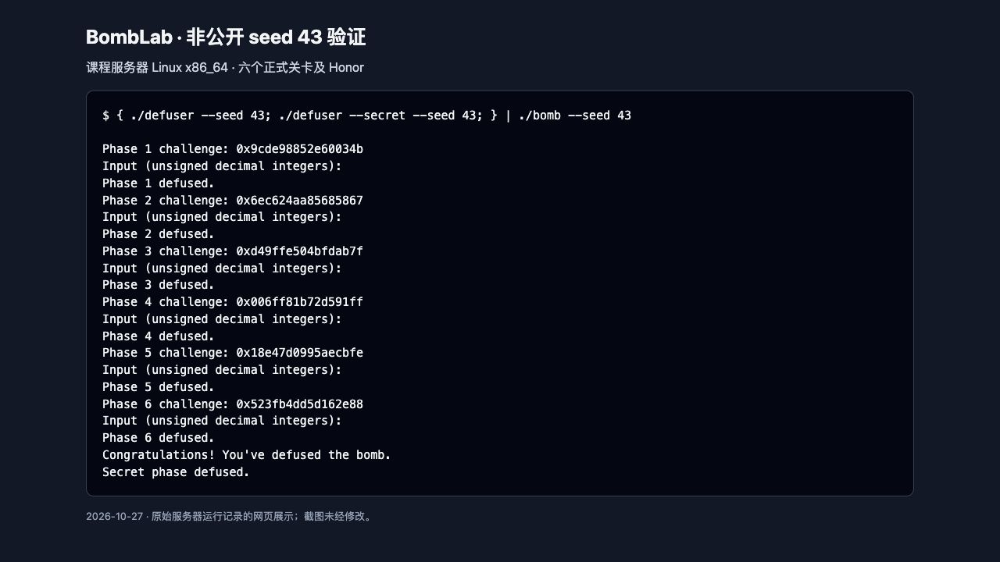
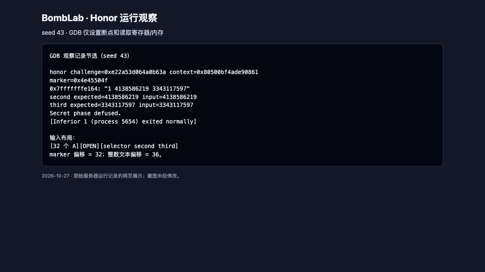
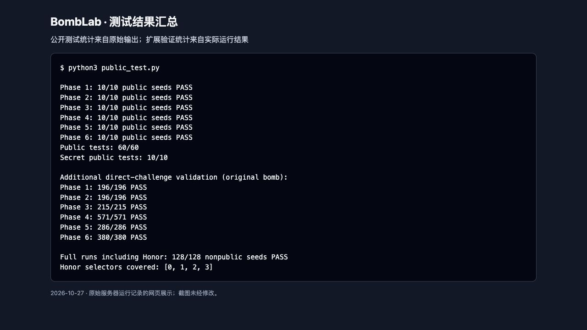

# Lab2：BombLab 实验报告

实验日期：2026 年 10 月 27 日。

## 1. 实验环境与方法

实验在课程服务器的 Linux x86_64 环境完成，使用 GCC 13.3.0、GDB 15.1、Python 3.12.3、GNU Make 和 objdump。个人炸弹由课程官方 Release 领取，压缩包通过官方 SHA-256 校验，解包时再次校验了炸弹文件。本文对应的 `bomb` SHA-256 为：

```text
f400d6f168a0543a885dadda391d41090f7139ebba48551b221e4552bdeadc3b
```

正式解法只修改 `defuser.c`，未修改接口、驱动、测试程序、Actions 工作流或炸弹。分析采用“静态反汇编恢复数据流，再用 GDB 在比较指令处核对数值”的方法。GDB 只用于设置断点、读取寄存器和内存，没有修改程序数据来绕过检查。

先用教学第 0 关熟悉入口参数与调试命令。其公开测试为 10/10；正式六关与 Honor 的结果另列于第 9 节。

以下用 `C` 表示当前关的 64 位 challenge，用 `U32(x)` 表示取低 32 位。所有恢复为 `uint32_t` 的加、减、乘、移位和异或均遵循原指令的 32 位语义；加、减、乘结果按模 2³² 回绕。对 challenge 的右移先在 64 位上执行，再按需要截取。

函数入口遵循 x86-64 Linux 调用约定，`rdi` 指向输入字符串，`rsi` 为 challenge；调用其他函数时，参数寄存器的含义重新确定。口令字段个数由 `valid_u32_fields` 的第二个参数和 `sscanf` 返回值比较共同确认。

## 2. 第 1 关：函数调用与参数传递

### 关键汇编

```asm
40209d: mov $0x1,%esi             # 只接受一个无符号整数
4020db: call p1_compute
4020e0: cmp %eax,-0x14(%rbp)      # 输入必须等于 helper 返回值

# p1_compute 的关键数据流
40205e: shr $0x20,%rax
402062: shr $0x10,%rsi
40206e: call p1_step1
40207a: call p1_step0
402083: call p1_step2
```

`p1_compute` 将 challenge 的高 32 位、低 32 位和右移 16 位后的低 32 位分别传给三个 helper。不能仅根据 helper 名称推测调用顺序，实际先调用 `p1_step1`，再调用 `p1_step0`，最后合并结果。

三个 helper 的关键指令分别为：

```asm
# p1_step0(a,b)
lea 0xc12c(%rsi),%eax
xor %edi,%eax
# p1_step1(a,b)
sub %esi,%edi
lea 0x24e1(%rdi,%rdi,2),%eax
# p1_step2(a,b)
lea (%rdi,%rsi,4),%eax
xor $0x778d,%eax
```

### 恢复的计算关系

```text
L = U32(C)
H = U32(C >> 32)
M = U32(C >> 16)
b = U32(3 * U32(H - M) + 0x24e1)
a = L XOR U32(H + 0xc12c)
answer = U32(a + 4*b) XOR 0x778d
```

实现中所有中间值使用 `uint32_t`。例如 `H-M` 可能发生无符号回绕，不能改成带有符号溢出的 `int` 运算。

### 非公开 seed 验证

seed 43 对应 challenge `0x9cde98852e60034b`，口令为 `3874529207`。GDB 在 `0x4020e0` 处观测到 `eax=3874529207`，栈上的输入值相同，随后输出 `Phase 1 defused.`。运行截图见第 9 节图 1。

## 3. 第 2 关：数组、循环和递推

### 关键汇编

```asm
4020fd: mov $0x6,%esi
402155: cmp $0x6,%eax
402160: shr $0x28,%rax
402164: and $0x3f,%eax
402167: lea (%rax,%rax,2),%eax
40216a: cmp %eax,%edx

402172: mov $0xa,%edi
402177: mov $0x15,%ecx
40217f: add %edx,%edx
402181: shr %cl,%rax
402184: and $0xf,%eax
402187: xor %edx,%eax
40218c: add %edi,%eax
402192: add $0x5,%ecx
402195: add $0xa,%edi
402198: add $0x4,%rsi
40219c: cmp $0x2e,%ecx
```

输入为六个整数。第一项取 challenge 右移 40 位后的低 6 位，再乘 3。之后 `rsi` 每次加 4，表明依次访问 4 字节数组元素；移位量从 21 开始每次加 5，加数从 10 开始每次加 10。比较移位量 46 时结束，因此恰好计算后五项。

### 恢复的计算关系

```text
a[0] = 3 * ((C >> 40) & 63)
对于 i = 1,2,3,4,5：
    part = (C >> (16 + 5*i)) & 15
    a[i] = U32((U32(2*a[i-1]) XOR part) + 10*i)
```

先异或再加上 `10*i`，不能把加法放入异或的另一侧。口令为六个数组元素，保持原顺序输出。

### 非公开 seed 验证

seed 43 的 challenge 为 `0x6ec624aa85685867`，口令为：

```text
108 221 463 953 1952 3956
```

GDB 在 `0x40218e` 处观测五次循环：

| 移位量 | 加数 | 程序期望值 | 输入值 |
|---:|---:|---:|---:|
| 21 | 10 | 221 | 221 |
| 26 | 20 | 463 | 463 |
| 31 | 30 | 953 | 953 |
| 36 | 40 | 1952 | 1952 |
| 41 | 50 | 3956 | 3956 |

随后输出 `Phase 2 defused.`，见图 1。

## 4. 第 3 关：switch 和跳转表

### 关键汇编与分支选择

```asm
402311: and $0x7,%edi
402314: cmp %edi,-0x18(%rbp)
40231f: shr $0x3,%rax
402323: shr $0x20,%rsi
402327: xor %eax,%esi
402329: call p3_dispatch
40232e: cmp %eax,-0x14(%rbp)

# p3_dispatch
402268: cmp $0x7,%eax
40226b: ja 4022b2
40226d: notrack jmp *0x405820(,%rax,8)
```

输入为两个整数，第一项必须等于 `s=C&7`。第二项由 `x=U32(C>>3) XOR U32(C>>32)` 经跳转表选择的运算得到。表项是 8 字节地址，且表中序号与 `p3_case_N` 名称的编号不一致，必须沿地址继续检查跳转目的地。

| s | 表项地址 | case 函数 | 第二个整数的计算关系 |
|---:|---|---|---|
| 0 | `0x402288` | `p3_case_2` | `U32(4*x) XOR 0xd27d` |
| 1 | `0x402290` | `p3_case_6` | `U32(4*x) XOR 0x6ee1` |
| 2 | `0x402298` | `p3_case_1` | `U32((x XOR 0x2238) + (x>>2))` |
| 3 | `0x4022a0` | `p3_case_4` | `U32(3*x + 0xdd6b)` |
| 4 | `0x4022a8` | `p3_case_0` | `U32(5*x + 0x7185)` |
| 5 | `0x4022b0` | `p3_case_7` | `U32(5*x + 0x50fa)` |
| 6 | `0x402278` | `p3_case_5` | `U32((x XOR 0xef84) + (x>>1))` |
| 7 | `0x402280` | `p3_case_3` | `U32(5*x + 0x31c18)` |

例如 `p3_case_3` 中的 `lea 0x31c18(%rdi,%rdi,4),%eax` 表示 `5*x+0x31c18`。实现采用与真实跳转表对应的 `switch`，并非硬编码某次运行的答案。

### 非公开 seed 验证

seed 43 的 challenge 为 `0xd49ffe504bfdab7f`，选择 s=7，口令为 `7 1432654931`。在 `0x40232e`，GDB 观测第二项期望值和输入值均为 `1432654931`，随后输出 `Phase 3 defused.`，见图 1。扩展测试覆盖了全部八个选择值。

## 5. 第 4 关：递归搜索和返回值组合

### 关键汇编

```asm
# phase_04：构造参数
402403: shr $0x20,%rax
402407: shr $0x7,%rcx
40240b: and $0x7f,%edi
40240e: mov $0x7f,%edx
402413: xor %eax,%ecx
402415: call p4_walk

# p4_walk：求中点并比较
sub %esi,%edi
shr $1,%edi
add %esi,%edi
cmp %eax,%edi
je 4023a0
# 左分支返回后的组合
lea (%rax,%rax,2),%eax
xor %ebx,%eax
xor $0x1b,%eax
# 右分支末尾改为 xor $0x1a,%eax
```

函数参数依次为 target、low、high、key。初始范围是 `[0,127]`，target 为 `C&127`，key 为 `U32(C>>7) XOR U32(C>>32)`。比较指令使用无符号条件跳转 `jb`，据此区分左右分支。

### 恢复的递归关系

令 `m=low+(high-low)/2`：

```text
若 target == m：
    return U32(m + 0x9e) XOR key
若 target < m：
    child = walk(target, low, m-1, key)
    return U32(3*child) XOR U32(m+key) XOR 0x1b
否则：
    child = walk(target, m+1, high, key)
    return U32(3*child) XOR U32(m+key) XOR 0x1a
```

口令只有一个整数，即 `walk(target,0,127,key)`。target 始终在范围内，每次递归严格缩小区间，必然命中基例。返回结果的组合发生在递归返回阶段，不能仅记录搜索路径而忽略每层的乘法和异或。

### 非公开 seed 验证

seed 43 的 challenge 为 `0x006ff81b72d591ff`，target=127；中点依次为 63、95、111、119、123、125、126、127。解法口令为 `3934665559`。在 `0x40241a`，GDB 中的 `eax` 和输入值均为该数，随后输出 `Phase 4 defused.`，见图 1。扩展测试覆盖全部 128 个 target，并改变高位数据验证 key 的参与。

## 6. 第 5 关：结构体布局与链表遍历

### 关键汇编和布局

```asm
402444: mov 0x405b60(,%rax,8),%rdx # 从头指针表选择起点
402459: mov 0x4(%rdx),%esi         # tag，偏移 4
402463: lea (%rax,%rax,2),%eax
402466: add (%rdx),%eax            # value，偏移 0
40246b: xor %esi,%eax
402477: mov 0x8(%rdx),%rdx         # next，偏移 8
402488: mov %esi,(%r8)             # 保存最后访问节点的 tag
```

由访问宽度和偏移可恢复出原节点布局：4 字节 value、4 字节 tag、8 字节 next，总大小 16 字节。节点区起点为 `0x405ba0`。下表用相对节点编号表示 next，避免在解法中依赖炸弹的绝对地址。

| 编号 | value | tag | next 编号 |
|---:|---|---|---:|
| 0 | `0x79bc` | `0x092c` | 4 |
| 1 | `0xf008` | `0x0847` | 5 |
| 2 | `0x9480` | `0x051f` | 6 |
| 3 | `0xc0e1` | `0x030b` | 11 |
| 4 | `0x9be0` | `0x066f` | 9 |
| 5 | `0x62d1` | `0x0b5f` | 3 |
| 6 | `0xd269` | `0x0a71` | 0 |
| 7 | `0x2c5b` | `0x0181` | 2 |
| 8 | `0x12ae` | `0x0761` | 7 |
| 9 | `0xeb19` | `0x042c` | 10 |
| 10 | `0xa813` | `0x0029` | NULL |
| 11 | `0xe1bd` | `0x0259` | 8 |

头指针表按序指向 `[1,5,3,11,8,7,2,6]`。这些表项是个人炸弹的固定数据，解法保存的是题目常量和连接关系，不是按 seed 查找答案。

### 恢复的计算关系

```text
node = heads[C & 7]
steps = (C >> 3) & 3
x = U32(C >> 6) XOR U32(C >> 32) XOR 0xc315
总计访问 steps+1 个节点，每次：
    x = U32(3*x + node.value) XOR node.tag
    last_tag = node.tag
    node = node.next
输出 x 和 last_tag
```

起始节点在循环判断前已经处理一次，故访问次数是 `steps+1`，而不是 steps。最大只需访问四个节点；逐一核对八个头指针，四次访问不会到达 NULL。

### 非公开 seed 验证

seed 43 的 challenge 为 `0x18e47d0995aecbfe`，起点选择值为 6，steps=3，访问顺序为 `2 → 6 → 0 → 4`。口令为 `3597458861 1647`，最后的 tag 是节点 4 的 `0x066f=1647`。GDB 在 `0x4024e8` 观测到返回值和输出参数分别为这两个数，随后输出 `Phase 5 defused.`，见图 1。扩展测试覆盖全部 8×4 种起点与步数组合。

## 7. 第 6 关：函数指针表与两次间接调用

### 关键汇编

```asm
40259c: shr $0x6,%rdi
4025a3: shr $0x20,%rax
4025a7: xor %eax,%edi
4025b0: and $0x38,%ebx
4025b3: and $0x7,%eax
4025b6: call *0x405e00(,%rax,8)
4025bd: xor $0x43b6,%eax
4025c4: call *0x405e00(%rbx)
4025cf: add $0xd986,%eax
```

函数表位于 `0x405e00`，每项 8 字节；`C&0x38` 直接产生第二次调用的字节偏移，等价的索引为 `(C>>3)&7`。两次索引分别取 challenge 的第 0–2 位和第 3–5 位。

| 函数表索引 | 实际函数 | 对输入 x 的运算 |
|---:|---|---|
| 0、4 | `p6_op_2` | `U32((x XOR (x>>2)) + 0x9c95)` |
| 1 | `p6_op_3` | `U32((x XOR 0xb286) + U32(x<<7))` |
| 2、5 | `p6_op_1` | `U32(x+0xbc47) XOR (x>>2)` |
| 3 | `p6_op_5` | 32 位循环右移 3 位 |
| 6 | `p6_op_0` | 32 位循环左移 5 位后异或 `0x544e` |
| 7 | `p6_op_4` | `U32(2*x+0xaecb) XOR U32(7*x)` |

### 恢复的计算关系

令 `F(s,x)` 表示上表运算：

```text
s1 = C & 7
s2 = (C >> 3) & 7
x = U32(C >> 6) XOR U32(C >> 32)
x = F(s1,x) XOR 0x43b6
answer = U32(F(s2,x) + 0xd986)
```

循环移位需同时保留从另一端移入的位。例如 32 位循环右移 3 位为 `(x>>3)|(x<<29)`；不能只写 `x>>3`。

### 非公开 seed 验证

seed 43 的 challenge 为 `0x523fb4dd5d162e88`，两次索引分别为 0 和 1，实际调用 `p6_op_2`、`p6_op_3`。口令为 `2073424169`。GDB 在 `0x402630` 观测期望值与输入相同，随后输出 `Phase 6 defused.`，见图 1。扩展测试覆盖全部 8×8 种索引组合。

## 8. Honor：入口布局与上下文相关校验

### 进入方式

从 `main` 可见，仅在完整运行六关且 stdin 不是交互终端时，程序继续读取非空白第七行。`transcript_context` 根据已通过的前六行生成 context；Honor challenge 由第 7 阶段生成。调用 `secret_gate(input,challenge,context)` 时，参数依次位于 `rdi`、`rsi`、`rdx`。

求解器的 `--secret` 路径由原始驱动负责计算 context，`solve_secret` 直接使用传入的两个数，不重新实现 seed 或上下文协议。

### 局部对象布局

```asm
40274b: lea -0xd0(%rbp),%r12
402771: sub $0x24,%rax
402775: cmp $0x7f,%rax
402779: jbe 402790
402796: call secret_copy
40279b: cmpl $0x4e45504f,-0xb0(%rbp)
4027ad: lea -0xac(%rbp),%rdi
4027b4: call secret_phase
```

`strlen(input)-36<=127` 是无符号比较，因此输入长度必须在 `[36,163]`。复制起点为 `rbp-0xd0`，标记位于 `rbp-0xb0`，相差 32 字节；随后交给 `secret_phase` 的整数文本位于 `rbp-0xac`，相差 36 字节。

标记整数 `0x4e45504f` 在小端序下对应字节 `4f 50 45 4e`，即 ASCII 字符串 `OPEN`。因此第七行构造为：

```text
[32 个字符 A][OPEN][s 的十进制表示][空格][b 的十进制表示][空格][d 的十进制表示]
```

`secret_copy` 会复制结尾 NUL。构造长度最多为 `32+4+1+1+10+1+10=59` 字节，加上 NUL 也在 gate 的局部对象范围内；此方法只覆盖指定的相邻字段，不覆盖保存的返回地址，也不使用 shellcode。

### 三个整数的计算关系

`secret_phase` 要求恰好三个无符号整数。用 T 表示 context：

```text
s = T & 3
A = U32(C) XOR U32(C >> 32)
B = U32(T) XOR U32(T >> 32)
b = ROR32(A XOR B,5) XOR 0x47d3
    XOR U32(s*0xa562) XOR U32(T >> 16)
d = b XOR U32(B + s + 0xe2b1 + (A >> 5))
```

依据是 `0x4026b5` 的 `and $3`、`0x4026c0` 的乘法、`secret_mix` 内的 `ror $5` 和异或，以及 `0x4026f1` 至 `0x402700` 的右移、求和与最终比较。第三项中 `A>>5` 为逻辑右移，且加法整体截断到 32 位后再异或。

### 非公开 seed 验证

seed 43 的 GDB 观测结果为：

```text
challenge = 0xe22a53d064a0b63a
context   = 0x80500bf4ade90861
marker    = 0x4e45504f
整数文本  = 1 4138586219 3343117597
second expected=4138586219 input=4138586219
third  expected=3343117597 input=3343117597
Secret phase defused.
```

完整通过记录见图 1，Honor 关键观察见图 2。128 个非公开 seed 的完整运行覆盖了 s=0、1、2、3。

## 9. 测试结果和运行截图

### 公开测试

使用原始 `Makefile` 的 `-std=c11 -O2 -Wall -Wextra -Wpedantic -Werror` 编译成功，运行原始 `public_test.py`：正式六关 60/60，Honor 10/10。公开 seed 列表为：

```text
0, 1, 7, 42, 99, 123, 2026, 65535, 987654321, 18446744073709551615
```

### 公开列表之外的验证

每关均使用非公开 seed 43 实际通过。复现方法如下：

```bash
make
./defuser --seed 43 --phase 1 | ./bomb --seed 43 --phase 1
# 对 phase 2 至 6，左右两边一起改为相应关卡。
{ ./defuser --seed 43; ./defuser --secret --seed 43; } | ./bomb --seed 43
python3 public_test.py
```

seed 43 的六行口令分别为：

| 关卡 | 口令 |
|---|---|
| 1 | `3874529207` |
| 2 | `108 221 463 953 1952 3956` |
| 3 | `7 1432654931` |
| 4 | `3934665559` |
| 5 | `3597458861 1647` |
| 6 | `2073424169` |

此外，以原始个人炸弹为检查器进行了以下扩展验证，所有用例均通过：

| 关卡 | 直接 challenge 数 | 重点覆盖 |
|---|---:|---|
| 1 | 196 | 全零、全一、单比特、32 位边界和确定性随机输入 |
| 2 | 196 | 六项递推、字段提取及不同高位数据 |
| 3 | 215 | 八种 switch 分支及不同运算输入 |
| 4 | 571 | 全部 128 个 target、多组 key、区间端点和递归基例 |
| 5 | 286 | 八个起点与四种步数的全部组合 |
| 6 | 380 | 两次函数选择的全部 64 种组合 |
| 合计 | 1844 | 各关分别传入 `--challenge`，与原炸弹核验 |

另外，128 个公开列表之外的 seed 均完整通过六关和 Honor，包括 43、314159、271828 等。随机源固定为 `random.Random(20261027)`；先生成 128 个用于直接 challenge 的随机数，再继续生成完整运行的 seed，排除公开列表和重复值。此处为本地扩展验证，不是助教的隐藏测试成绩。

截图展示服务器实际运行记录的浏览器排版页面；图 2 是 GDB 输出节选，图 3 是原始测试输出与扩展验证结果的汇总。截图不是交互终端窗口截图，页面仅用于展示运行记录，不参与求解。

**图 1：非公开 seed 43 的六关与 Honor 完整通过。**



**图 2：Honor 的实际参数、标记与比较结果。**



**图 3：公开测试和扩展验证汇总。**



## 10. 资料与辅助工具

1. [课程 Lab2 实验指引](https://ics-26fall-fdu.github.io/labs/lab2-bomb-lab/)。
2. 课程学生模板的 [tutor 教学](https://github.com/ICS-26Fall-FDU/BombLab/blob/main/tutor/README.md)、[teaching 配套示例](https://github.com/ICS-26Fall-FDU/BombLab/blob/main/teaching/README.md)，以及模板中的接口、驱动和公开测试。
3. 本人对应的个人炸弹，通过 objdump 静态反汇编与 GDB 动态观察获得计算关系和固定数据表。

辅助工具用途：objdump 用于读取指令和只读数据；GDB 用于观察调用参数、循环和比较结果；Python 用于批量测试与整理实际运行记录；Codex 用于辅助汇编分析、解法实现、测试核对和报告整理。本文中的验证结果均来自实际运行，未把辅助工具的文字推测当作测试结果。
